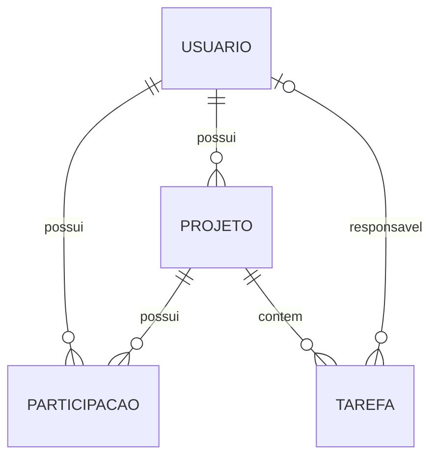

# Especificação de Requisitos de Software — ORBT

**Referência:** ISO/IEC/IEEE 29148:2018  
**Versão:** 0.4 — MVP revisado<br>
**Data:** 29/10/2026  
**Cliente fictício:** Agência Criativa StartUp  
**Estado:** MVP implementado; execução local com MongoDB standalone.

Este documento é organizado com base na ISO/IEC/IEEE 29148:2018 e utiliza como referência de apresentação o [README do Fit Life](https://github.com/Muski360/fit_life). Sua estrutura, por si só, não comprova conformidade com a norma.

## 1. Introdução

### 1.0 Configuração local

Pré-requisitos: Node.js **22.18 ou superior**, npm e MongoDB local em execução. O Compass é o cliente para inspecionar o banco; a aplicação se conecta ao serviço MongoDB.

No PowerShell:

```powershell
npm install
Copy-Item .env.example .env.local
node -e "console.log(require('node:crypto').randomBytes(48).toString('hex'))"
```

Cole o valor gerado em `JWT_SECRET` no arquivo `.env.local` e confira as demais variáveis. Se o arquivo já existir, preserve sua configuração.

| Variável | Uso |
| --- | --- |
| `MONGODB_URI` | Conexão de uso, por padrão `mongodb://127.0.0.1:27017/orbt`. |
| `JWT_SECRET` | Segredo aleatório com pelo menos 32 bytes para assinar JWTs. |
| `APP_URL` | Origem da aplicação, por padrão `http://localhost:3000`. Use uma URL `https://` quando houver HTTPS; ela também determina o atributo Secure do cookie. |
| `MONGODB_TEST_URI` | Banco exclusivo dos testes, por padrão `mongodb://127.0.0.1:27017/orbt_test`. |

O arquivo `.env.local` é ignorado pelo Git. Nunca versione credenciais, chaves reais ou strings de conexão de ambientes compartilhados.

```powershell
npm run db:seed
npm run dev
```

Acesse [localhost:3000/login](http://localhost:3000/login). Entre com **admin@admin.com** e **admin123123**. A inicialização cria índices e a conta inicial quando ausentes; executá-la novamente não sobrescreve contas, senhas ou projetos. As contas cadastradas pela interface sempre são membros; não há promoção a gerente.

Rotas: `/` apresenta a landing e sua demonstração local; `/login` autentica; `/projetos` lista projetos; `/projetos/[id]` contém o quadro persistido; `/membros` é exclusiva do gerente.

Para executar uma compilação de produção local:

```powershell
npm run build
npm start
```

### 1.0.1 Arquitetura

- `src/app`: rotas App Router, consultas em Server Components e alterações em Server Actions.
- `src/components/landing`: landing e estado da demonstração; independente do banco.
- `src/components/kanban`: quadro compartilhado, colunas, tarefas, arraste e navegação horizontal.
- `src/components/workspace`: navegação autenticada e telas do produto.
- `src/components/ui`: formulários, campos, diálogos, confirmações, botões e indicadores compartilhados.
- `src/lib/workspace`: regras e consultas separadas em projetos, membros, tarefas e autorização.
- `src/lib`: conexão MongoDB, sessões JWT, credenciais bcrypt, validação Zod, tipos, conversão de documentos e formatação.
- `scripts/seed.ts`: inicialização idempotente do banco.
- `tests`: integração com MongoDB e fluxos Playwright.

A organização, as correções da revisão e as convenções de manutenção estão em [Arquitetura e revisão do site](docs/architecture.md).

O driver oficial MongoDB utiliza as coleções `users`, `projects`, `tasks` e `sessions`. Projetos armazenam proprietário e participantes; tarefas armazenam projeto e responsável opcional. IDs são UUIDs em formato string. Índices atendem consultas por proprietário, participação e projeto, e garantem e-mail único. O índice TTL elimina sessões expiradas; a autorização verifica a expiração mesmo antes da limpeza automática.

O JWT dura uma hora e corresponde a uma sessão no banco. Sair revoga essa sessão; não há renovação automática. Senhas usam bcrypt com custo 12 e limite técnico de 72 bytes UTF-8. E-mails são normalizados; dez tentativas inválidas consecutivas bloqueiam a conta por quinze minutos. Dados autenticados ficam fora de cache compartilhado, com carregamentos dinâmicos dentro de Suspense.

Cada alteração verifica autenticação e permissões no servidor. A interface usa CSS Modules, dnd-kit e Motion, com suporte a teclado, toque e movimento reduzido, seguindo a [identidade visual](docs/visual-identity.md). Não há ordenação manual persistida entre tarefas da mesma coluna. Alterações de outras pessoas aparecem pelo botão **Atualizar** ou ao recarregar.

### 1.0.2 Exclusões e falhas

O MongoDB local standalone não oferece transações entre coleções. Exclusões registram um estado pendente antes da limpeza e bloqueiam o acesso correspondente. A aplicação só confirma sucesso ao terminar. O gerente pode usar **Concluir exclusão** ou **Concluir retirada** para retomar operações interrompidas; tarefas de contas removidas são preservadas sem responsável.

Gravações relacionadas a um projeto usam uma trava temporária no documento para evitar conflitos com exclusões e retiradas. Se o processo for interrompido, a trava expira em até sessenta segundos; aguarde esse período e tente novamente. Durante o salvamento de uma movimentação, o quadro bloqueia novas movimentações. Se a gravação falhar, restaura o estado anterior e apresenta o erro.

### 1.0.3 Verificação

```powershell
npm run lint
npm run test:server
npm run test:e2e
```

Os testes exigem MongoDB disponível e utilizam exclusivamente **orbt_test**, com proteção contra outra seleção de banco. Não limpam o banco `orbt`. A integração usa registros identificados por teste e remove seus próprios dados ao terminar; um teste de navegador interrompido pode deixar dados com prefixo `E2E` em `orbt_test`.

Playwright compila a aplicação, inicializa o banco de teste e abre uma instância independente na porta **3100**, com segredo próprio para testes. A configuração utiliza o **Google Chrome instalado** (`channel: chrome`). As verificações cobrem autenticação, expiração e revogação, permissões, CRUD, reatribuição, chamadas diretas às Server Actions, persistência, falha de salvamento, retomada de exclusões, arraste, teclado, toque emulado e responsividade.

Na revisão local de 29/10/2026, os oito testes de servidor e os nove testes de navegador passaram. Também foram conferidos persistência e sessão, telas entre 320 e 1440 px e dezesseis estados de tela ou diálogo com axe, sem violações automáticas detectadas. Toque foi emulado no Chrome; não houve validação em aparelhos físicos ou de uma implantação HTTPS. O resultado detalhado está em [Arquitetura e revisão do site](docs/architecture.md).

### 1.1 Propósito

Definir os requisitos do ORBT para orientar o desenvolvimento, a validação e a avaliação do produto por cliente, equipe de desenvolvimento e testes.

### 1.2 Escopo

O ORBT será um gerenciador web de tarefas para equipes. Cada projeto terá um quadro Kanban com as colunas **A Fazer**, **Em Andamento** e **Concluído**. Usuários autenticados poderão acompanhar o trabalho e executar ações de acordo com seu papel e sua participação no projeto.

O MVP compreende autenticação, gerenciamento de contas e membros de projetos, CRUD de projetos e tarefas, quadro Kanban e movimentação por arrastar e soltar. Os dados serão armazenados em MongoDB.

### 1.3 Termos

| Termo | Definição |
| --- | --- |
| Projeto | Agrupamento de tarefas e membros, com um gerente proprietário. |
| Tarefa | Trabalho associado a um projeto, com título, descrição, status e responsável opcional. |
| Gerente / administrador | Mesmo papel, responsável também pela gestão de contas e associação de membros. |
| Membro | Usuário que participa de projetos e atua nas tarefas conforme suas permissões. |
| Kanban | Quadro que organiza tarefas em colunas correspondentes aos seus status. |
| CRUD | Criação, consulta, alteração e exclusão. |
| JWT | Token utilizado na autenticação das requisições. |
| bcrypt | Algoritmo utilizado para gerar e verificar hashes de senhas. |
| RF / RNF / RN | Requisito funcional / requisito não funcional / regra de negócio. |

## 2. Descrição geral

### 2.1 Problema e objetivo

As tarefas são distribuídas informalmente, dificultando a identificação do que deve ser feito, está em andamento ou foi concluído. O ORBT deve centralizar projetos e tarefas e tornar seu andamento visível para a equipe.

### 2.2 Usuários e permissões

| Ação | Gerente / administrador | Membro comum |
| --- | --- | --- |
| Autenticar-se | Sim | Sim |
| Criar, consultar, editar e excluir projetos | Criar projetos e gerenciar os que lhe pertencem | Consultar projetos dos quais participa |
| Criar contas de membros e excluir contas | Sim | Não |
| Associar e retirar membros de projetos | Sim | Não |
| Criar tarefas | Sim | Em projetos dos quais participa |
| Consultar quadro e tarefas | Sim | Em projetos dos quais participa |
| Editar, excluir e mudar o status de tarefas | Sim | Somente tarefas atribuídas a si |
| Atribuir ou reatribuir tarefas | Nos projetos que lhe pertencem | Nos projetos dos quais participa, ao criar uma tarefa ou alterar uma tarefa atribuída a si |

O banco de dados será inicializado com uma conta de gerente: **admin@admin.com**, senha inicial **admin123123**. A senha deve ser armazenada como hash bcrypt. Essas credenciais são destinadas ao ambiente escolar controlado.

### 2.3 Ambiente e restrições

- Aplicação web; o repositório atual utiliza Next.js, React e TypeScript.
- Persistência em MongoDB, com configuração de conexão protegida.
- Autenticação com JWT e armazenamento de senhas como hashes bcrypt.
- A aplicação será responsiva para uso em diferentes tamanhos de tela, em ambiente escolar controlado.
- Não foram definidos limites de negócio adicionais para campos ou volume de dados; permanecem os limites técnicos do MongoDB, das Server Actions e de 72 bytes UTF-8 por senha bcrypt.
- O cadastro de contas será simples, adequado à atividade escolar; não foi solicitado um fluxo completo de recuperação de senha ou entrega de credenciais.

## 3. Requisitos funcionais

Todos os requisitos desta seção têm prioridade **alta** e pertencem ao MVP. Os critérios descrevem o comportamento de aceite; os comandos de verificação estão na seção 1.0.3.

### RF-001 — Autenticar usuário

O sistema deve permitir que um usuário com conta válida entre com suas credenciais.

- [ ] Credenciais válidas concedem acesso e geram um JWT.
- [ ] Credenciais inválidas não concedem acesso.
- [ ] Recursos protegidos exigem autenticação válida e verificam as permissões do usuário.
- [ ] O usuário pode encerrar a sessão; após o encerramento, o JWT daquela sessão não concede acesso aos recursos protegidos.
- [ ] Após a expiração da sessão, o usuário deve autenticar-se novamente.

### RF-002 — Gerenciar contas de membros

O sistema deve permitir ao gerente cadastrar membros e excluir contas de membros.

- [ ] Um gerente pode cadastrar uma conta de membro e suas credenciais.
- [ ] A inicialização do banco cria a conta de gerente indicada na seção 2.2, sem duplicá-la em inicializações posteriores.
- [ ] Um gerente pode excluir uma conta de membro após confirmação.
- [ ] A exclusão retira a participação da conta nos projetos e deixa sem atribuição suas tarefas, preservando-as.
- [ ] Um membro comum não pode executar essas operações.

### RF-003 — Criar projeto

O sistema deve permitir que o gerente crie um projeto com nome e descrição.

- [ ] O nome é obrigatório; a descrição é opcional.
- [ ] Um projeto válido é persistido e fica disponível para consulta.
- [ ] O gerente que cria o projeto é registrado como seu proprietário.

### RF-004 — Consultar projetos

O sistema deve permitir a consulta dos projetos acessíveis ao usuário.

- [ ] O gerente pode consultar os projetos que lhe pertencem.
- [ ] Um membro comum pode consultar os projetos dos quais participa.
- [ ] A consulta apresenta o nome e a descrição do projeto quando informada.

### RF-005 — Alterar projeto

O sistema deve permitir que o gerente altere o nome e a descrição de um projeto que lhe pertence.

- [ ] O nome não pode ficar vazio.
- [ ] As alterações válidas são persistidas e apresentadas na consulta posterior.

### RF-006 — Excluir projeto

O sistema deve permitir que o gerente exclua um projeto que lhe pertence.

- [ ] Antes da exclusão, o sistema informa que as tarefas associadas também serão excluídas e solicita confirmação.
- [ ] Ao confirmar, o projeto e suas tarefas são excluídos.
- [ ] Ao cancelar, o projeto e suas tarefas são mantidos.

### RF-007 — Gerenciar membros de projeto

O sistema deve permitir que o gerente associe contas de membros a um projeto que lhe pertence e retire membros dele.

- [ ] Um membro associado passa a poder acessar o projeto conforme suas permissões.
- [ ] Um membro retirado deixa de ter acesso ao projeto por essa associação.
- [ ] As tarefas atribuídas ao membro retirado permanecem no projeto e ficam sem atribuição.
- [ ] Retirar um membro de um projeto não exclui sua conta.

### RF-008 — Criar tarefa

O sistema deve permitir que o gerente e os membros de um projeto criem tarefas nesse projeto.

- [ ] A tarefa possui título, descrição, projeto associado, status e responsável opcional.
- [ ] O título é obrigatório; a descrição é opcional.
- [ ] Quando informado, o responsável deve pertencer ao projeto.
- [ ] Uma tarefa pode ser criada sem responsável.
- [ ] Ao criar uma tarefa, o membro pode atribuí-la a um integrante do projeto ou deixá-la sem atribuição.
- [ ] A tarefa é persistida e exibida na coluna correspondente ao seu status.
- [ ] Toda tarefa começa em **A Fazer**.

### RF-009 — Consultar tarefas e quadro Kanban

O sistema deve apresentar as tarefas de um projeto em um quadro Kanban aos usuários autorizados.

- [ ] O quadro exibe as colunas **A Fazer**, **Em Andamento** e **Concluído**.
- [ ] Cada tarefa aparece na coluna correspondente ao seu status e exibe seu título e responsável, quando houver.
- [ ] O usuário autorizado pode consultar os detalhes da tarefa, incluindo descrição e projeto.
- [ ] Um membro pode identificar as tarefas atribuídas a si.

### RF-010 — Alterar tarefa

O sistema deve permitir a alteração de tarefas por usuários autorizados.

- [ ] O gerente pode alterar tarefas; o membro comum pode alterar somente tarefas atribuídas a si.
- [ ] O membro pode reatribuir uma tarefa atribuída a si a outro integrante do projeto ou deixá-la sem responsável. Após a reatribuição, suas permissões sobre essa tarefa seguem a nova atribuição.
- [ ] O título permanece obrigatório e o responsável, quando informado, pertence ao projeto.
- [ ] As alterações válidas são persistidas e refletidas na consulta e no quadro.

### RF-011 — Excluir tarefa

O sistema deve permitir a exclusão de tarefas por usuários autorizados.

- [ ] O gerente pode excluir tarefas; o membro comum pode excluir somente tarefas atribuídas a si.
- [ ] A exclusão é solicitada com confirmação; o cancelamento preserva a tarefa.
- [ ] Após a confirmação, a tarefa deixa de aparecer no quadro e nas consultas.

### RF-012 — Movimentar tarefa no Kanban

O sistema deve permitir que um usuário autorizado altere o status de uma tarefa arrastando-a para outra coluna.

- [ ] O gerente pode movimentar tarefas; o membro comum pode movimentar somente tarefas atribuídas a si.
- [ ] Ao soltar a tarefa em uma coluna válida, o status é atualizado e persistido.
- [ ] São permitidas transições entre quaisquer dois dos três status.
- [ ] Após recarregar o quadro, a tarefa permanece na coluna correspondente ao status salvo.
- [ ] O sistema também oferece uma forma de mudar o status sem arrastar, utilizável por teclado.
- [ ] Se a alteração falhar, o sistema informa o usuário e mantém ou restaura o status persistido.

## 4. Requisitos não funcionais e interfaces

| ID | Requisito e verificação | Prioridade |
| --- | --- | --- |
| RNF-001 | O sistema deve persistir contas, projetos, participações e tarefas no MongoDB; verificar sua recuperação após reiniciar a aplicação. | Alta |
| RNF-002 | O sistema deve gerar hashes de senhas com bcrypt e verificá-las sem armazenar senhas em texto puro; verificar os registros e o processo de autenticação. | Alta |
| RNF-003 | O sistema deve validar assinatura e validade do JWT antes de conceder acesso a recursos protegidos; testar tokens inválidos e expirados. | Alta |
| RNF-004 | O sistema deve verificar a autorização no servidor para cada operação protegida, inclusive quando chamadas forem feitas diretamente; testar acessos fora das permissões. | Alta |
| RNF-005 | Credenciais de conexão e chaves de assinatura não devem ser incluídas no código-fonte versionado; inspecionar a configuração e o repositório. | Alta |
| RNF-006 | O sistema deve validar os campos obrigatórios e os valores de status no servidor e informar erros ao usuário; testar dados ausentes e inválidos. | Alta |
| RNF-007 | O quadro e seus controles devem permitir navegação por teclado e apresentar nomes acessíveis; verificar o fluxo de consulta e alteração de status sem mouse. | Alta |
| RNF-008 | O sistema deve informar falhas de gravação sem apresentar a operação como concluída; verificar com uma falha de persistência simulada. | Alta |
| RNF-009 | A interface deve adaptar-se a telas de computador e celular, mantendo os controles utilizáveis; verificar os fluxos principais nos dois tamanhos. | Alta |
| RNF-010 | O JWT deve expirar após 1 hora; não haverá renovação automática, sendo necessário entrar novamente. Verificar o acesso após a expiração. | Alta |
| RNF-011 | O JWT deve ser guardado em cookie HttpOnly, com SameSite=Lax e Secure quando houver HTTPS; a implantação fora do ambiente local deve usar HTTPS. Verificar os atributos e o transporte. | Alta |
| RNF-012 | O encerramento de sessão deve invalidar o JWT no servidor até sua expiração e remover o cookie; testar a reutilização do token após sair. | Alta |

### Interfaces externas

- **Usuário:** interface web para autenticação, projetos, contas, membros, tarefas e quadro Kanban.
- **Dados:** conexão com MongoDB para leitura e gravação dos dados do sistema.
- **Autenticação:** credenciais verificadas por bcrypt e acesso a recursos protegidos mediante JWT válido.

## 5. Regras de negócio

| ID | Regra | Requisitos relacionados |
| --- | --- | --- |
| RN-001 | Gerente e administrador designam o mesmo papel. | RF-002 a RF-012 |
| RN-002 | Cada tarefa pertence a um projeto e tem exatamente um dos três status definidos. | RF-008, RF-009, RF-012 |
| RN-003 | Uma tarefa pode não ter responsável; quando atribuído, o responsável deve pertencer ao projeto. | RF-007, RF-008, RF-010 |
| RN-004 | O membro comum pode criar tarefas nos projetos dos quais participa, mas só pode editar, excluir ou mudar o status de tarefas atribuídas a si. | RF-008, RF-010 a RF-012 |
| RN-005 | Retirar um membro de um projeto ou excluir sua conta deixa suas tarefas correspondentes sem responsável. | RF-002, RF-007 |
| RN-006 | A exclusão confirmada de um projeto também exclui suas tarefas. | RF-006 |
| RN-007 | Um gerente só pode gerenciar projetos de sua propriedade e suas tarefas e membros. | RF-003 a RF-012 |
| RN-008 | Um membro pode atribuir uma tarefa ao criá-la e reatribuir apenas uma tarefa atribuída a si. | RF-008, RF-010 |

## 6. Modelo conceitual



O diagrama representa relações de negócio; não define o formato físico das coleções MongoDB.

## 7. Riscos

| Risco | Consequência | Tratamento previsto |
| --- | --- | --- |
| Exclusão de projeto ou conta por engano | Perda de tarefas no caso do projeto ou retirada de atribuições no caso da conta. | Solicitar confirmação e informar o efeito antes da exclusão. |
| Acesso indevido | Exposição ou alteração de dados da equipe. | Autenticação e autorização no servidor, hashes bcrypt e validação de JWT. |
| Falha na conexão com MongoDB | Operações podem não ser concluídas. | Informar a falha e não apresentar gravações malsucedidas como concluídas. |

## 8. Histórico de versões

| Versão | Data | Alteração |
| --- | --- | --- |
| 0.1 | 29/10/2026 | Levantamento inicial do MVP e registro das decisões e pendências. |
| 0.2 | 29/10/2026 | Atualização das decisões sobre contas, permissões, projetos, sessão e ambiente. |
| 0.3 | 29/10/2026 | Implementação do MVP com autenticação, MongoDB, permissões, quadros persistidos e testes; instruções de instalação e retomada de exclusões. |
| 0.4 | 29/10/2026 | Revisão dos fluxos, autenticação, acessibilidade e arquitetura; componentes compartilhados, código padronizado e novos testes de regressão. |
