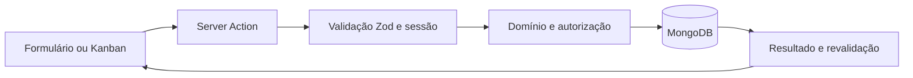

# ORBT — arquitetura e revisão do site

Revisão realizada em **29/10/2026**, no escopo do MVP escolar definido no [README](../README.md).

## Escopo revisado

Foram revisados a landing, o login, a lista de projetos, o quadro de um projeto, a gestão de membros, os formulários, as confirmações, os carregamentos e a recuperação de erros. A análise também abrangeu Server Actions, autenticação, sessões, autorização, validações, consultas, exclusões em cascata e testes.

A identidade brutalista, o MongoDB local e as permissões do MVP foram preservados.

## Problemas corrigidos

| Prioridade | Problema observado no código | Correção |
| --- | --- | --- |
| Alta | Tentativas simultâneas de login podiam sobrescrever a contagem de falhas. | A contagem e o bloqueio passam a ser calculados em uma atualização atômica no MongoDB; um login válido também respeita um bloqueio iniciado durante a verificação da senha. |
| Alta | Uma tarefa removida em outra aba podia ser interpretada como uma nova tarefa, pois ambas usavam `task = null`. | O modo de criação é explícito; detalhes de uma tarefa removida mostram um estado de indisponibilidade. |
| Alta | Uma falha de transporte podia escapar do formulário e interromper a tela. | O formulário mostra uma mensagem recuperável, preserva os campos e permite tentar novamente; redirecionamentos do Next.js continuam sendo propagados. |
| Alta | Consultas de projetos pendentes dependiam parcialmente do papel recebido pelo chamador. | A autorização de leitura verifica o papel atual no banco, inclusive para projetos em exclusão. |
| Média | Diálogos podiam fechar durante uma gravação e perder o contexto visual da operação. | O fechamento por botão ou Escape fica indisponível até a conclusão da requisição. |
| Média | Salvar executava a revalidação da Server Action e depois outro `router.refresh()`. | A interface utiliza os dados devolvidos na mesma resposta da ação. O botão Atualizar permanece como atualização manual. |
| Média | Confirmações, campos de seleção, tipos de cartões e iniciais tinham implementações repetidas. | Foram centralizados em componentes, tipos e funções compartilhados. |
| Média | Campos de descrição e atribuição eram opcionais na interface, mas ausentes na requisição eram rejeitados pelo esquema. | A descrição recebe texto vazio e o responsável recebe `null` quando omitidos, preservando a validação dos campos obrigatórios. |
| Média | A navegação do celular ocupava três faixas altas. | Marca, identificação e saída compartilham a primeira faixa; a navegação ocupa a segunda. |
| Média | Código JSX, tipos e CSS concentravam muitas instruções na mesma linha. | A formatação foi padronizada e as consultas ganharam variáveis locais com nomes explícitos. |
| Média | A mensagem de acesso indisponível podia renderizar um `main` dentro do `main` da área autenticada. | As mensagens de erro e página indisponível são compartilhadas; cada rota define o contêiner apropriado e a área autenticada preserva um único `main`. |
| Baixa | Estados de carregamento colocavam a mensagem ao vivo dentro de um ancestral marcado como ocupado. | O texto de carregamento permanece disponível para anúncio durante a espera. |

Também foram mantidos os ajustes do Kanban: dimensões do cartão preservadas durante o arraste, alça alinhada ao ponto segurado, indicação do destino, cancelamento imediato, alternativa por status, foco de teclado e movimento reduzido.

## Estrutura do código

```text
src/
  app/
    (workspace)/       Rotas autenticadas e consultas em Server Components
    login/             Entrada na aplicação
    actions.ts         Validação das requisições, autenticação e revalidação
    error.tsx          Recuperação de erros inesperados
    loading.tsx        Carregamento geral
  components/
    landing/           Apresentação e demonstração com estado local
    kanban/            Quadro, coluna, cartão, arraste e navegação
    ui/                Formulários, campos, diálogos, confirmações e loaders
    workspace/         Telas e interações próprias de projetos e membros
  lib/
    workspace/
      access.ts        Usuário ativo, proprietário, participação e trava
      projects.ts      Consulta e alterações de projetos
      members.ts       Contas e participações
      tasks.ts         Alterações e permissões de tarefas
    auth.ts            Sessão atual e proteção de rotas
    credentials.ts     Verificação bcrypt e bloqueio de tentativas
    session.ts         Assinatura, validação e revogação de JWT
    db.ts              Conexão e documentos MongoDB
    views.ts           Conversão de documentos para dados públicos da interface
    types.ts           Contratos compartilhados e status do Kanban
    validation.ts      Esquemas Zod das entradas
    format.ts          Formatação compartilhada de iniciais
    seed.ts            Índices e conta inicial
```

### Caminho de uma alteração



As regras de acesso ficam em `lib/workspace/access.ts` e são usadas pelos domínios. Os componentes controlam apresentação, edição e estados de interação; a autorização permanece no servidor.

O layout autenticado renderiza a estrutura de forma síncrona. Somente a navegação consulta a sessão, dentro de seu próprio `Suspense`, sem redirecionar no layout. Cada página e Server Action mantém `requireUser()` antes de acessar os dados. Isso permite que a validação de navegação instantânea alcance as páginas durante o prefetch, inclusive quando não há sessão.

As consultas de rota retornam dados próprios para a interface. `views.ts` seleciona explicitamente os campos públicos de usuários e projetos. Hashes, tokens de sessão e dados da trava não são enviados aos componentes do navegador.

`ActionForm` reúne envio, validação, falha de rede, foco e estado de gravação. `ConfirmDialog` combina esse comportamento com a confirmação de uma operação. Seus estilos ficam em `components/ui`, com os mesmos botões compartilhados pelas telas. Os arquivos de `workspace` tratam os fluxos do produto.

O tipo `TaskCardData` descreve o conteúdo usado pelo Kanban. `TaskView` acrescenta os dados do projeto, descrição e responsável. A demonstração e o quadro persistido usam os mesmos componentes de cartão.

### Convenções para manutenção

- Acrescentar uma regra de projeto, membro ou tarefa no domínio correspondente e verificá-la no servidor.
- Validar novos campos em `validation.ts` antes de utilizá-los em uma Server Action.
- Manter os campos permitidos explícitos nas gravações e nas respostas ao navegador.
- Reaproveitar os componentes de `ui` para novos formulários e confirmações.
- Deixar as Server Actions atualizarem a tela; usar `router.refresh()` para a ação manual de atualização.
- Executar integração somente em `orbt_test`. Os testes possuem uma proteção contra a seleção de outro banco.

## Verificação e limites

Comandos de verificação:

```powershell
npm run lint
npm run test:server
npm run test:e2e
```

A integração cobre autenticação, JWT inválido ou expirado, revogação, tentativas concorrentes, propriedade, participação, atribuição de tarefas, persistência e retomada de exclusões. Os testes de navegador cobrem os fluxos completos, chamadas manipuladas, recuperação de rede, preservação de campos, validação, diálogos em gravação, tarefa removida em outra aba, logout em outra aba, arraste, teclado, toque emulado e responsividade.

Resultados da revisão:

| Verificação | Resultado |
| --- | --- |
| ESLint | Sem erros. |
| Compilação de produção e TypeScript | Concluídos. |
| Integração com MongoDB | Oito testes passaram. |
| Playwright no Chrome | Nove testes passaram. |
| axe | Dezesseis estados sem violações automáticas detectadas. |
| Reflow das telas principais | Verificado em 320, 390, 768 e 1440 px, incluindo nomes e títulos longos. |
| `npm audit --omit=dev` | Nenhuma vulnerabilidade conhecida reportada para as dependências de produção na data da revisão. |

Os dezesseis estados revisados com axe foram: landing, login, validação do login, projetos, criação de projeto, membros, cadastro de membro, quadro do gerente, participantes, edição de tarefa, confirmação de exclusão, página inexistente, tarefa em modo de leitura, acesso de membro à área de gerentes, projetos vazios e erro de conexão com o banco. Este último foi simulado em uma instância local separada, sem interromper o MongoDB de uso.

O MongoDB continua standalone. As exclusões têm etapas idempotentes e podem exigir retentativa. A trava de projeto continua limitada a sessenta segundos para operações curtas do ambiente escolar. A revisão não substitui uma avaliação de implantação pública, carga de produção, leitura por tecnologias assistivas ou uso em aparelhos físicos.
